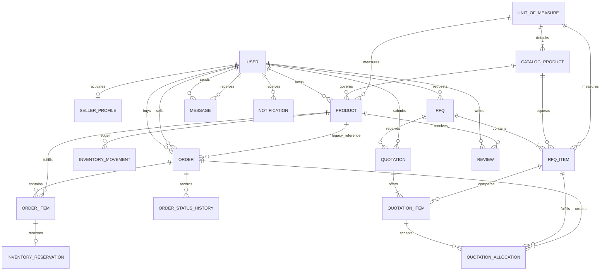

# Database ER diagram

All trading foreign keys use restricted deletion so historical records cannot be cascaded away. Row-version columns protect mutable aggregates. Unique operation keys make inventory, status, allocation, and notification side effects idempotent.
